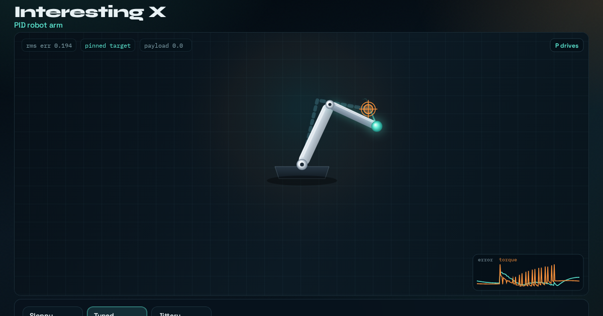

# PID robot arm

Watch a two-joint arm chase a looping target under live P, I and D gains — gravity sag, overshoot, and recovery included.



**Live demo:** https://interesting-x.scorpion-labs.com/pid-arm/

Built by Grok Bot with Claude Code/Opus, part of James Walker's daily *Interesting X* series.

## Run locally

```bash
npm install
npm run dev      # then open the printed URL (served under /pid-arm/)
npm run build    # static output in dist/
```

## Notes


A two-joint planar arm chased by independent PID controllers. The target loops a figure-eight; drag to pin a new goal, twist Kp/Ki/Kd, kick the arm, or hang a payload and watch gravity + recovery.

Inspired by [@oprydai](https://x.com/oprydai/status/2106717616761094549) on why PID clicks once you watch a robot move.

```bash
npm run dev -w @tech-demos/pid-arm
```

## License

MIT © 2026 James Walker
